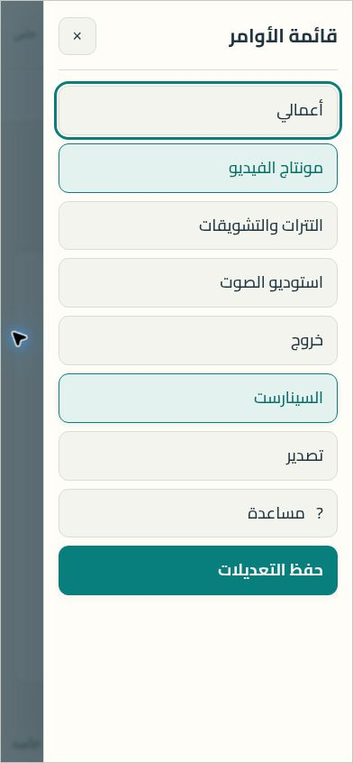

# قائمة الأوامر الجانبية

تُفتح من زر «القائمة» أعلى اليمين في محرر السيناريو والكتب. تضم الأزرار الأصلية: أعمالي، مونتاج الفيديو، التترات والتشويقات، استوديو الصوت، خروج، السينارست، تصدير، مساعدة، وحفظ التعديلات. يبقى إشعار الحفظ خارج القائمة.

يحافظ `studio-command-menu.mjs` على أزرار React ومعالجاتها في مواضعها الأصلية، ويستخدم CSS لعرض شريط الأوامر داخل درج جانبي. زر الحفظ داخل القائمة يعكس حالة الزر الأصلي ويستدعيه. يعاد تركيب القائمة عند تبديل المحرر، وتُزال عند الخروج. لا يقرأ المسار محتوى العمل ولا يغيّر الدخول أو التخزين.

تغلق القائمة عند اختيار أمر، أو الضغط خارجها، أو Escape. يُحصر تركيز لوحة المفاتيح داخلها أثناء فتحها، وتُحترم إعدادات تقليل الحركة.

المعاينة من بيئة React مستقلة بنص تجريبي. تم التحقق من عرض 390 بكسل دون تمرير أفقي، والتصدير، والحفظ وحالة التعطيل أثناء التنفيذ، وإعادة العرض، وتبديل محرر الكتب، والخروج، وEscape والتنقل بـTab. لم يتضمن الاختبار دخولاً إلى أعمال خاصة أو استدعاء مزود حي. فحص الحزمة الإنتاجية مستقل ويُنفذ في مسار النشر الحالي.
